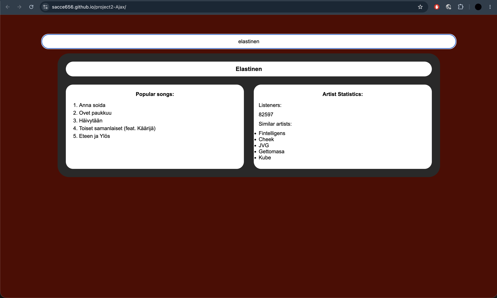

Music explorer

Samu asplund

## Project plan

### Project idea

The idea is to create a app where you can search artists or bands and get information such as their top 5 most listened songs, monthly listeners and similar bands/artists. The application is made with last.fm api. The application can be used by anyone who wants get more information about music in general.

### Planned features

List at least three features you plan to include in your application:

- Feature 1
User can search a artist/band and get their top 5 most listened songs
- Feature 2
The application will display their monthly listeners
- Feature 3
The application will display similiar artists based on their music.
- Feature 4
Display artists most listened albums

### Wireframe / sketch

Add an image of your hand-drawn or digitally created application wireframe here. The wireframe should show the main view and the most important elements of your application.

Example:

## Web links

- **Published application:** [Add your GitHub Pages URL here](https://sacce656.github.io/project2-Ajax/)
- **GitHub repository:** [Add your repository URL here](https://github.com/SaCCe656/project2-Ajax)
- **Project video presentation:** [Add your video URL here](https://www.youtube.com/watch?v=1nrvdg5zSQA)

## About the application

**[Music Explorer]** is a web application that ...

Can inform its users about bands that they either know or don't know beforehand. It can be used to learn about already know artists or discover artists that are similar to the one you like

## Technologies

Describe the technologies you used and their role in your project.

HTML – Structure and content of the website.

CSS – Styling and layout of the website.

JavaScript – Functionality, artist search and DOM manipulation.

Last.fm API – Provides artist information, popular songs and listener statistics.

Fetch API (AJAX) – Fetches data asynchronously from the Last.fm server.

JSON – Data format used to receive and process API responses.

GitHub – Version control and storing the project code.

## How to use the application

Write short instructions for using the application.

1. Open the published application using the link above.
2. Fill in the artist you would like to know about
3. See the data the application provides
4. Find more about other artists by searching another one

## Running the application locally

1. Clone or download this repository to your computer.
2. Open the project folder.
3. Open `index.html` in a web browser.

## Screenshots

Add at least one screenshot of your working application.

Example:

## Known issues / limitations

Invalid artist searches: Searching for an artist that does not exist may cause an error or leave outdated information on the page.

Empty search input: The application does not currently validate empty searches.

Listener statistics: Listener counts are based on Last.fm data and do not represent total listeners across all music platforms.

## Self-assessment and learning reflection

Reflect on your work and learning process.

- What did I succeed in?

Making a simple but working application with a purpose that it achieves.

- What was challenging?
Learning how to use a API that I had never used before. I found it hard to find tutorials or commands how to use the API.

- What would I improve if I had more time?
Make the application more complex, for example display picture of artist/band and searchbar assumptions etc.

- What did I learn about HTML, CSS, JavaScript and DOM scripting?
Learned how to use the API in question.

JavaScript: I learned how to use the Fetch API to request data from an external API and process JSON responses. I also practiced using variables, functions and loops.

DOM scripting practise, how to update content on the webpage, how to use fetch api and practice with loops.

- What remained unclear or what would I like to learn more about?
I would like to learn how to handle errors properly and make the application more reliable. Learning more about different APIs could also be cool since now I begin to understand there must be millions of different kinds of APIs.
- My self-assessed project grade: **6/10 points**

## Sources and acknowledgements

List all sources, tutorials, images and code examples used in your project.

ChatGPT (OpenAI) – I used ChatGPT to create the initial CSS structure, and understand how to use the Last.fm API with JavaScript. ChatGPT also helped explain JavaScript functions, DOM manipulation and debugging errors. I used it as a learning tool to understand the code and implement the application's functionality.

Rather than using AI to code for me, it was used to teach me how to code a working application (excluding css file). AI was used to get the picture function to work it was too hard.

## License

This project is licensed under the MIT License.

More information about adding a license to a GitHub repository:  
https://docs.github.com/en/communities/setting-up-your-project-for-healthy-contributions/adding-a-license-to-a-repository